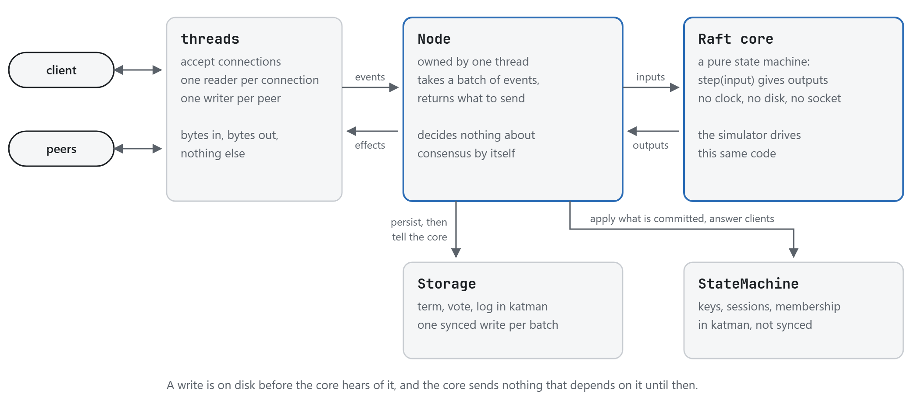
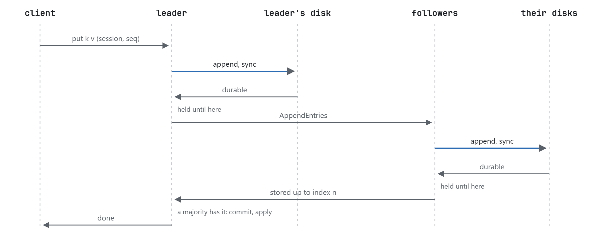
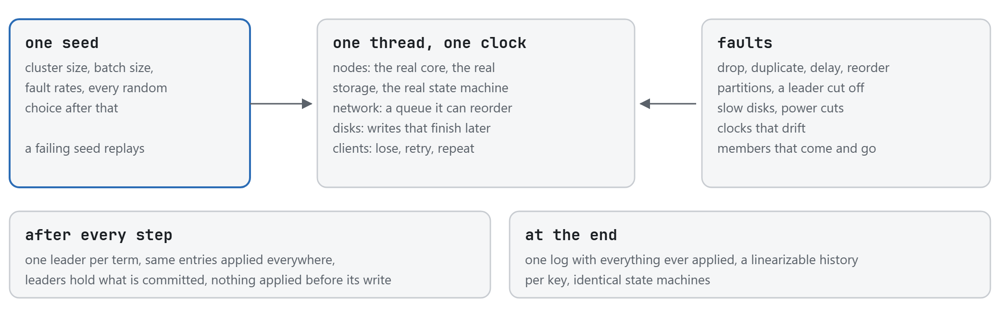

# quorate

A linearizable key-value store for Rust, replicated with Raft and stored in [katman](https://github.com/tunahanaliozturk/katman).

A meeting is *quorate* when enough members are present to make a binding decision. A cluster of nodes needs the same for every write.

## Status

All eight milestones are done. quorate runs: a `quorate` binary starts a node or talks to a cluster, over TCP, with data on disk. It is a study, not a product: there is no authentication and no encryption.

## Try it

```
cargo build --release
```

Three nodes on one machine, each in its own terminal:

```
quorate serve --id 1 --listen 127.0.0.1:7001 --data data/1 --peer 1=127.0.0.1:7001 --peer 2=127.0.0.1:7002 --peer 3=127.0.0.1:7003
quorate serve --id 2 --listen 127.0.0.1:7002 --data data/2 --peer 1=127.0.0.1:7001 --peer 2=127.0.0.1:7002 --peer 3=127.0.0.1:7003
quorate serve --id 3 --listen 127.0.0.1:7003 --data data/3 --peer 1=127.0.0.1:7001 --peer 2=127.0.0.1:7002 --peer 3=127.0.0.1:7003
```

Then, with `S="--server 1=127.0.0.1:7001 --server 2=127.0.0.1:7002 --server 3=127.0.0.1:7003"`:

```
quorate status $S
quorate put greeting hello $S
quorate get greeting $S
quorate cas greeting hello world $S
```

Kill the node that `status` shows as leader, with `kill -9` or the task manager. The other two elect a new one within a second or two, `get` still answers, and the node catches up when it is started again. A node is only ever stopped by killing it; there is no other way.

`compose.yaml` starts the same three nodes in containers.

## How it works

<picture>
  <source media="(prefers-color-scheme: dark)" srcset="docs/images/node-dark.png">
  
</picture>

The Raft core is a pure state machine. It reads no clock, opens no file and no socket; it is given inputs and returns what it wants done. The node around it does those things and nothing else, and the threads around the node only move bytes. That split is what lets the simulator run the same core for years of cluster time in a minute.

A write, from request to answer:

<picture>
  <source media="(prefers-color-scheme: dark)" srcset="docs/images/write-dark.png">
  
</picture>

Nothing leaves a node on the strength of state that could still be lost. The leader does not send an entry before its own disk has it, and a follower does not acknowledge one before its disk has it.

## Numbers

One laptop, loopback, every node a separate process, all on one SSD. Full tables, the machine and the caveats are in [docs/benchmarks.md](docs/benchmarks.md).

| | 3 nodes | 5 nodes |
| --- | --- | --- |
| puts per second, 1 client | 170 to 550 | 490 to 500 |
| puts per second, 16 clients | 2,500 to 2,700 | 1,800 to 1,900 |
| gets per second, 16 clients | 15,000 to 19,000 | 8,200 to 16,000 |
| median put latency, 16 clients | 5 ms | 8 ms |

Each range is two passes of the same benchmark; they differ that much on this machine. A killed leader is replaced, and writes go through again, in 0.5 to 1.0 seconds.

Sixteen clients write faster than one because requests that arrive together share one sync. The first version did not do that and managed 170 puts a second however many clients there were; the benchmark is what showed it.

## What is tested

<picture>
  <source media="(prefers-color-scheme: dark)" srcset="docs/images/simulator-dark.png">
  
</picture>


A real cluster under fire, in `tests/kill.rs`: three processes, four clients, the leader killed four times. About 9,000 operations per run are answered and their history is linearizable.

The simulator, which is where most of the evidence comes from. All of it is reproducible with `cargo test`:

- 10,000 seeds, each 1,500 ticks on a cluster of three or five nodes plus two spares, break no safety property. The faults are dropped, duplicated and delayed messages, changing partitions, slow disks, drifting clocks, power cuts, membership changes at random moments, and clients that lose requests and replies and send them again. A weekly job runs 200,000 seeds.
- After the faults stop and every node is back, every seed converges on one fully committed log that holds every entry any node ever applied. No acknowledged entry is lost.
- The history of every key is linearizable, with most reads served by the leader without a log entry, and the state machines of all members end up byte for byte identical. The first 1,000 seeds complete 92 client operations each on average.
- Logs stay bounded. Nodes compact every 8, 32 or 128 applied entries, and followers that fall behind are caught up with snapshots: 8,212 of them in the first 1,000 seeds.
- The membership changes while all of this goes on: 8,014 committed changes in the first 1,000 seeds. A separate run replaces every node of the cluster with a new one, one step at a time under client load, 1,000 times.
- Seven rules are switched off one at a time to prove the simulator would notice. Of the first 1,000 seeds, the missing log check on votes fails 734, compacting the log before the state machine is on disk fails 523, carrying out a retried request twice fails 356, sending a message before its write is durable fails 152, answering a read without confirming leadership fails 27, and accepting a membership change while another is in flight fails 17. Committing an earlier term's entry by counting replicas (figure 8 of the Raft paper) fails none of the first 1,000; that chain of events is too rare to leave to chance, so a unit test walks through it step by step, with the rule and without.

A failing seed replays exactly with `QUORATE_SEED=n cargo test`.

- [docs/design.md](docs/design.md): what it does, what it does not do, and how each promise will be tested.
- [docs/roadmap.md](docs/roadmap.md): milestones, each with an exit test.
- [docs/adr/](docs/adr/): decisions that are hard to reverse.

## What it will promise

| Promise | How it will be tested |
| --- | --- |
| Every operation is linearizable, also during leader changes and partitions. | Client histories from the simulator are checked by a linearizability checker. |
| A write that was acknowledged survives the crash of any minority of nodes, and a power cut on all of them. | Simulated nodes run on katman's `SimFs`, which forgets unsynced bytes when a node is cut. |
| A retried request is applied once. | Client sessions with sequence numbers; the simulator duplicates and replays messages. |
| The Raft safety properties hold after every step. | The simulator asserts election safety, log matching, leader completeness and state machine safety on every tick. |
| Any failure is reproducible from one integer. | The Raft core does no I/O and reads no clock. A seed decides message order, delays, drops, partitions and crashes. |

## Why another Raft

The point is the testing method, not the algorithm. The core is a pure state machine: inputs in, outputs out. That makes it possible to run years of cluster time per CI minute on one thread, with faults that are rare in production happening thousands of times per run.

## Licence

Dual licensed under [MIT](LICENSE-MIT) or [Apache 2.0](LICENSE-APACHE), at your option.
